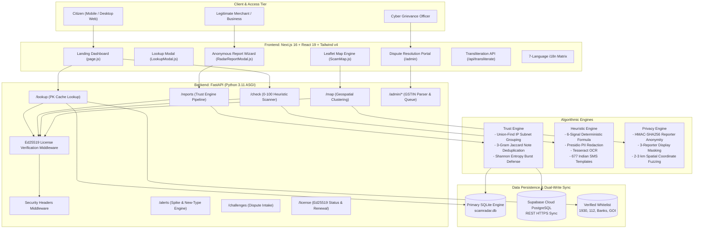

# ScamRadar India — Community Scam Defense & Early-Warning Platform

> **CyberForge Hackathon — Problem Statement #4: Community Scam-Checking & Early-Warning System**  
> *An anonymous, privacy-preserving, multilingual cyber-intelligence platform engineered to protect Indian citizens from financial extortion, digital arrests, and online fraud.*

---

## Table of Contents
1. [Executive Summary & Problem Statement](#1-executive-summary--problem-statement)
2. [End-to-End System Architecture](#2-end-to-end-system-architecture)
3. [Repository Directory Structure](#3-repository-directory-structure)
4. [Master API Catalog & Endpoint Matrix](#4-master-api-catalog--endpoint-matrix)
   - [4.1 System & Health Checks](#41-system--health-checks)
   - [4.2 Anonymous Fraud Reporting](#42-anonymous-fraud-reporting)
   - [4.3 Rapid Threat Lookup & Verdict Resolution](#43-rapid-threat-lookup--verdict-resolution)
   - [4.4 Geospatial Threat Clusters (Map API)](#44-geospatial-threat-clusters-map-api)
   - [4.5 Spatio-Temporal Dynamic Alerts](#45-spatio-temporal-dynamic-alerts)
   - [4.6 Merchant Dispute / Challenge Intake](#46-merchant-dispute--challenge-intake)
   - [4.7 Ed25519 Cryptographic Licensing System](#47-ed25519-cryptographic-licensing-system)
   - [4.8 Multi-Signal Heuristic Message Scanner](#48-multi-signal-heuristic-message-scanner)
   - [4.9 Grievance Officer Dispute Management Queue](#49-grievance-officer-dispute-management-queue)
   - [4.10 Admin Test Reset Engine](#410-admin-test-reset-engine)
5. [Key Technological Innovations](#5-key-technological-innovations)
   - [5.1 Sybil-Resilient Trust Engine (Union-Find, Jaccard, Shannon Entropy)](#51-sybil-resilient-trust-engine)
   - [5.2 Deterministic 0–100 Multi-Signal Message Scanner](#52-deterministic-0100-multi-signal-message-scanner)
   - [5.3 Privacy Preservation & DPDP Act 2023 Compliance](#53-privacy-preservation--dpdp-act-2023-compliance)
   - [5.4 Ed25519 Asymmetric Licensing & Anti-Rollback Guard](#54-ed25519-asymmetric-licensing--anti-rollback-guard)
   - [5.5 Merchant Redressal & MCA/GSTIN Verification Shield](#55-merchant-redressal--mcagstin-verification-shield)
   - [5.6 Multilingual Accessibility & Regional Voice Intake](#56-multilingual-accessibility--regional-voice-intake)
6. [Complete Installation & Setup Guide](#6-complete-installation--setup-guide)
   - [6.1 Backend Setup (FastAPI)](#61-backend-setup-fastapi)
   - [6.2 Frontend Setup (Next.js 16)](#62-frontend-setup-nextjs-16)
7. [Environment Variables Reference](#7-environment-variables-reference)
8. [Automated QA Test Suite (All 16 Scenarios)](#8-automated-qa-test-suite-all-16-scenarios)
9. [Hackathon Live Demonstration Guide (For Jury)](#9-hackathon-live-demonstration-guide-for-jury)
10. [Licensing & Credits](#10-licensing--credits)

---

## 1. Executive Summary & Problem Statement

India is experiencing an unprecedented surge in organized cyber fraud, inflicting thousands of crores in financial losses on citizens every year. Key fraud archetypes include:
- **Digital Arrest Extortion**: Impersonation of CBI, Mumbai Police, Customs, or the Enforcement Directorate via Skype/WhatsApp video calls, coercing victims into wire transfers to avoid "arrest".
- **Electricity Disconnection Phishing**: Mass SMS alerts threatening power shutoff at 9:30 PM unless a fraudulent number is called or a malicious APK/link is downloaded.
- **Part-Time Task & Deposit Scams**: Promises of ₹3,000–₹8,000/day for liking YouTube videos or rating hotels on Telegram, culminating in advance-fee investment theft.
- **UPI QR Code & Reversal Tricks**: Deceptive payment requests claiming "scan QR to receive funds".

### The Solution: ScamRadar India
ScamRadar is an open, privacy-preserving, crowdsourced intelligence platform that empowers citizens to verify suspicious calls, links, and SMS senders in under **0.5 seconds**, while enabling anonymous incident reporting and neighborhood surge alerting.

---

## 2. End-to-End System Architecture



---

## 3. Repository Directory Structure

```
scan-radar/
└── community-scam/
    ├── backend/                          # FastAPI Python 3.11 Backend
    │   ├── app/
    │   │   ├── checker/                  # 0-100 Rule-Based Heuristic Scanner
    │   │   │   ├── data/                 # Lexicons, tactics, Indian scam templates
    │   │   │   ├── rules/                # Language, brand, link, and payment rules
    │   │   │   ├── pipeline.py           # Multi-stage asynchronous inspection pipeline
    │   │   │   ├── router.py             # POST /check endpoint (SSE & JSON)
    │   │   │   └── state.py              # In-memory execution state
    │   │   ├── data/                     # Seed datasets (25 metro areas, verified helplines)
    │   │   ├── models/                   # SQLAlchemy 2.0 Async ORM models
    │   │   ├── routers/                  # API routers (reports, lookup, map, alerts, etc.)
    │   │   ├── schemas/                  # Pydantic v2 validation models
    │   │   ├── services/                 # Trust engine, normaliser, privacy, licensing
    │   │   ├── config.py                 # Pydantic BaseSettings environment config
    │   │   ├── database.py               # AsyncSessionLocal & init_db SQLite engine
    │   │   └── main.py                   # FastAPI application factory & middlewares
    │   ├── licenses/                     # Demo Ed25519 cryptographic license files
    │   ├── scripts/                      # License generator & database seeding utilities
    │   ├── tests/                        # Pytest suite covering all 16 test scenarios
    │   ├── .env.example                  # Backend environment template
    │   ├── Dockerfile                    # Container configuration
    │   ├── requirements.txt              # Python package dependencies
    │   └── README.md                     # Comprehensive backend documentation
    │
    ├── frontend/                         # Next.js 16 Web Application
    │   ├── public/                       # Manifest, icons, static assets
    │   ├── src/
    │   │   ├── app/                      # Next.js App Router (page.js, /map, /admin)
    │   │   ├── components/               # UI components, modals, radar sweeps
    │   │   ├── data/                     # 25 Indian metro centroids
    │   │   └── lib/                      # api-client.js, i18n.js multilingual engine
    │   ├── package.json                  # Next.js, React 19, Leaflet, Tailwind v4
    │   ├── next.config.ts                # Next.js configuration
    │   └── README.md                     # Comprehensive frontend documentation
    │
    ├── scamradar-documentation.md        # Technical specification
    ├── scamradar-solution-deepdive.md    # Deep dive architectural writeup
    ├── SCAMRADAR_JURY_PRESENTATION.md    # Hackathon evaluation slide deck
    ├── SCAMRADAR_PROBLEM_AND_TOTAL_SOLUTION.md # Problem and solution analysis
    └── scamradar_qa_test_report.md       # Comprehensive QA test verification report
```

---

## 4. Master API Catalog & Endpoint Matrix

All API responses are standard JSON. The table below lists all endpoints provided by the backend:

| # | HTTP Verb | Endpoint Path | Description | Access Control | Primary Response Codes |
|---|---|---|---|---|---|
| 1 | `GET` | `/health` | Lightweight service healthcheck | Public (No license check) | `200` |
| 2 | `GET` | `/` | Root system status and license state | Public (No license check) | `200` |
| 3 | `POST` | `/reports` | Submit anonymous citizen fraud report | Ed25519 License Check | `201`, `400`, `429` |
| 4 | `GET` | `/lookup` | Single-PK lookup (Phone, UPI, URL, Sender) | Ed25519 License Check | `200`, `400` |
| 5 | `GET` | `/map` | 7-day spatial threat clusters (25 metro hubs) | Ed25519 License Check | `200` |
| 6 | `GET` | `/alerts` | Dynamic scam surge alerts (`SPIKE` & `NEW_TYPE`) | Ed25519 License Check | `200` |
| 7 | `POST` | `/challenges` | Business dispute grievance intake | Ed25519 License Check | `201`, `400` |
| 8 | `GET` | `/license` | Query Ed25519 license validity & remaining time | Public (No license check) | `200` |
| 9 | `POST` | `/license` | Hot-reload license file with Ed25519 verification | Public (No license check) | `200`, `400` |
| 10 | `POST` | `/check` | 0–100 heuristic scanner for text & screenshots | Ed25519 License Check | `200` (SSE / JSON), `400`, `429` |
| 11 | `POST` | `/admin/login` | Grievance officer credential authentication | Public | `200`, `401` |
| 12 | `POST` | `/admin/auth/google` | Grievance officer Google OAuth login | Public (Whitelist checked) | `200`, `401` |
| 13 | `GET` | `/admin/auth/config` | Retrieve OAuth client and whitelist configuration | Public | `200` |
| 14 | `GET` | `/admin/me` | Officer session profile & badge verification | Protected (`Bearer` token) | `200`, `401` |
| 15 | `GET` | `/admin/disputes` | Paginated list of merchant disputes | Protected (`Bearer` token) | `200`, `401` |
| 16 | `GET` | `/admin/disputes/{id}` | Single dispute details with parsed GSTIN & PAN | Protected (`Bearer` token) | `200`, `401`, `404` |
| 17 | `POST` | `/admin/disputes/{id}/decide`| Approve or reject dispute (Shields business) | Protected (`Bearer` token) | `200`, `400`, `401`, `404`, `409` |
| 18 | `POST` | `/admin/reset` | Purge data and reset rate limiters for testing | Protected (`ENABLE_ADMIN_RESET`) | `200`, `403` |

---

### Detailed Endpoint Deep Dives

#### 4.1 System & Health Checks
- **`GET /health`**:
  - Response `200 OK`: `{"ok": true}`. Bypasses the license middleware; used by load balancers and container orchestrators.
- **`GET /`**:
  - Returns backend metadata:
    ```json
    { "service": "ScamRadar Backend API", "status": "online", "version": "1.0.0", "license_status": "valid" }
    ```

#### 4.2 Anonymous Fraud Reporting
- **`POST /reports`**:
  - Submits an incident report. Normalizes phone numbers to E.164 (`+919876543210`), hashes reporter ID and IP subnet using `HMAC-SHA256`, checks rate limits, and triggers Trust Engine evaluation.
  - **Body**:
    ```json
    {
      "reporter_id": "client_session_8819",
      "ip_prefix": "49.207.12.0",
      "channel": "phone_call",
      "scam_type": "digital-arrest",
      "identifier_type": "phone",
      "identifier_value": "+91 98765 43210",
      "pincode": "560102",
      "locality": "HSR Layout",
      "city": "Bengaluru",
      "note": "Caller claimed to be DCP Mumbai Police threatening arrest over FedEx parcel.",
      "amount_lost_inr": 50000.0,
      "has_screenshot": false
    }
    ```
  - **Success Response (`201 Created`)**:
    ```json
    {
      "report_id": "d8a1b2c3d4e5f6...",
      "case_id": "CASE-98B1C2A3",
      "merged": false
    }
    ```

#### 4.3 Rapid Threat Lookup & Verdict Resolution
- **`GET /lookup?type={phone|upi|url|sender_id}&value={query}`**:
  - Queries phone number, UPI handle, URL, or SMS header. Completes in **< 0.5s** via a single primary-key index lookup.
  - Returns `VERIFIED_BUSINESS` for official entities (e.g. 1930, 112, official banks).
  - Returns `KNOWN_SCAM` when confirmed by $\ge 3$ independent reporter groups.
  - Returns `SUSPICIOUS` if reports exist but thresholds are not yet reached.
  - Returns `NO_REPORTS` (`200 OK`, never `404`) if unknown.
  - Masks identifier (`98XXXXX210`) if fewer than 3 independent reports exist.

#### 4.4 Geospatial Threat Clusters (Map API)
- **`GET /map?days=7&radius_km=2.0`**:
  - Aggregates scam incidents over the last 1–30 days. Fuzzes coordinates by 2–3 km around the pincode centroid for citizen privacy. Returns cluster severity, counts, and top scam types across 25 metro areas.

#### 4.5 Spatio-Temporal Dynamic Alerts
- **`GET /alerts?pincode={pincode}`**:
  - Emits `SPIKE` warnings when report volume is $\ge 2\times$ the 30-day baseline average (minimum 5 reports).
  - Emits `NEW_TYPE` warnings when a scam archetype is detected in a pincode for the first time.

#### 4.6 Merchant Dispute / Challenge Intake
- **`POST /challenges`**:
  - Allows merchants and businesses to contest erroneous scam flags.
  - **Immediate Safety Shield**: Demotes `KNOWN_SCAM` to `SUSPICIOUS`, flags `challenged: true`, and enqueues the record for Grievance Officer review.

#### 4.7 Ed25519 Cryptographic Licensing System
- **`GET /license`**: Returns licensee, status (`valid` or `expired`), and remaining seconds.
- **`POST /license`**: Verifies 64-byte Ed25519 digital signature over canonical payload `f"{licensee}:{expires_at}"`. Instantly updates license state in memory **without server restart**.

#### 4.8 Multi-Signal Heuristic Message Scanner
- **`POST /check?stream={true|false}`**:
  - Analyzes suspicious text, URLs, or screenshot images.
  - Evaluates 6 deterministic signals (Community, Risky Link, Pressure Language, Known Template, Impersonation, Unusual Payment) on a 0–100 scale.
  - Streams progress steps via Server-Sent Events (SSE) or returns synchronous JSON. Presidio cleans PII from memory; text/images are **never persisted**.

#### 4.9 Grievance Officer Dispute Management Queue
- **`POST /admin/login`**: Authenticates officer with username and password; returns a 12-hour bearer token.
- **`POST /admin/auth/google`**: Authenticates officer via Google OAuth; verifies email against `ADMIN_ALLOWED_EMAILS`.
- **`GET /admin/disputes`**: Lists pending and resolved disputes with status filters.
- **`GET /admin/disputes/{id}`**: Returns parsed GSTIN, state code, PAN, and attached documents.
- **`POST /admin/disputes/{id}/decide`**: Approves (shields entity as `VERIFIED_BUSINESS`) or rejects dispute.

#### 4.10 Admin Test Reset Engine
- **`POST /admin/reset`**: Wipes mutable tables and resets rate limiters for integration testing.

---

## 5. Key Technological Innovations

### 5.1 Sybil-Resilient Trust Engine
The platform scores **independent human confirmations** rather than raw submission counts:
1. **IP Subnet Union-Find Clustering**: Groups reports sharing the same `/24` IP prefix within 24 hours into a single independent entity ($\text{distinct\_reporters} = 1$).
2. **Character 3-Gram Jaccard Similarity**: Detects copy-pasted notes across different accounts ($J(A,B) \ge 0.70$) and merges them into one voice.
3. **Shannon Entropy Burst Defense**: Flags coordinated burst waves with low temporal entropy ($H < 0.35$). Brand-new accounts carry a baseline weight of $0.3$, preventing report-bombing against innocent local shops.

### 5.2 Deterministic 0–100 Multi-Signal Message Scanner
Computes transparent, explainable risk scores without unexplainable black-box models:
- **Community Threat Signal (Max 30 pts)**: Queries crowdsourced database in real time.
- **Risky Link Signal (Max 20 pts)**: Detects Punycode lookalikes, URL shorteners, direct IP hosts, and fresh domains.
- **Pressure Language Signal (Max 20 pts)**: Identifies urgent deadlines, arrest threats, and OTP demands.
- **Known Template Match (Max 15 pts)**: Fuzzy token matches against 677 circulating Indian scam SMS templates.
- **Impersonation Signal (Max 10 pts)**: Identifies unauthorized use of institutional brand names (SBI, HDFC, CBI, TRAI).
- **Unusual Payment Vector (Max 5 pts)**: Detects UPI collect requests, crypto addresses, and gift cards.
- **Hard Risk Floors**: Elevates score directly to $\ge 61$ (High Risk) if Digital Arrest or credential harvesting patterns are detected.

### 5.3 Privacy Preservation & DPDP Act 2023 Compliance
- **HMAC-SHA256 Anonymization**: Device IDs and IP subnets are hashed with a server secret; raw identifiers are never saved.
- **3-Reporter Display Masking**: Identifiers are masked (`98XXXXX210`, `f***@okaxis`) until at least 3 independent people report them.
- **2–3 km Spatial Fuzzing**: Incident coordinates on the map are fuzzed around the pincode center to prevent victim doxxing.
- **Presidio & Regex Sanitization**: Strips 12-digit Aadhaar numbers, 10-character PANs, and personal emails before database insertion.

### 5.4 Ed25519 Asymmetric Licensing & Anti-Rollback Guard
- Protects software integrity via 32-byte public key Ed25519 signature checks.
- When expired, immediately returns `403 Forbidden` (`LICENSE_EXPIRED`) while safeguarding existing database records.
- Hot-reloads in memory via `POST /license` with zero downtime.
- Tracks `last_seen_time` in database to reject system clock manipulation.

### 5.5 Merchant Redressal & MCA/GSTIN Verification Shield
- Prevents weaponization of scam reporting against legitimate businesses and competitors.
- Automatically parses 15-digit GSTINs, validates state codes against all 36 Indian States/UTs, and extracts the corporate PAN.
- Filing a challenge immediately demotes `KNOWN_SCAM` to `SUSPICIOUS`, preventing reputational damage while under review.

### 5.6 Multilingual Accessibility & Regional Voice Intake
- Supports 7 Indian languages: English, Hindi, Telugu, Tamil, Kannada, Marathi, Bengali.
- Features speech-to-text voice reporting for semi-literate citizens.
- Includes a dedicated transliteration API (`/api/transliterate`) for Latin-to-Indic script conversion.

---

## 6. Complete Installation & Setup Guide

### 6.1 Backend Setup (FastAPI)

```bash
# 1. Clone repository and navigate to backend
cd community-scam/backend

# 2. Set up Python virtual environment
python -m venv venv
# On Windows:
venv\Scripts\activate
# On Linux/macOS:
source venv/bin/activate

# 3. Install Python dependencies
pip install -r requirements.txt

# 4. Configure environment variables
cp .env.example .env

# 5. Start development server
uvicorn app.main:app --host 0.0.0.0 --port 8000 --reload
```

Backend will be running at `http://localhost:8000`.  
Interactive Swagger docs: `http://localhost:8000/docs`.

### 6.2 Frontend Setup (Next.js 16)

```bash
# 1. Open a new terminal and navigate to frontend
cd community-scam/frontend

# 2. Install Node dependencies
npm install

# 3. Configure environment variables
cp .env.example .env.local

# 4. Start Next.js development server
npm run dev
```

Frontend will be running at `http://localhost:3000`.

---

## 7. Environment Variables Reference

### Backend (`backend/.env`)
| Variable | Default Value | Purpose |
|---|---|---|
| `DATABASE_URL` | `sqlite+aiosqlite:///scamradar.db` | Async database connection string. |
| `HMAC_SECRET_KEY` | `scamradar-super-secret-hmac-key-2026` | Secret key for hashing reporter IDs and IP prefixes. |
| `ENABLE_ADMIN_RESET` | `true` | Allows `POST /admin/reset` for test automation. |
| `LICENSE_PUBLIC_KEY` | Built-in 32-byte Hex Key | Public key for Ed25519 license verification. |
| `SUPABASE_URL` | `https://psvmzqigzpvzbggrmhvw.supabase.co` | Supabase Cloud instance URL. |
| `SUPABASE_PUBLISHABLE_KEY` | `sb_publishable_...` | Supabase public API key. |
| `ADMIN_USERNAME` | `admin` | Default Grievance Officer login username. |
| `ADMIN_PASSWORD` | `scamradar-admin-2026` | Default Grievance Officer login password. |
| `ADMIN_KEY` | `scamradar-admin-2026` | Static admin token for automated test suites. |
| `ADMIN_ALLOWED_EMAILS` | `officer.grievance@cybercrime.gov.in,...` | Authorized Google OAuth email whitelist. |

### Frontend (`frontend/.env.local`)
| Variable | Default Value | Purpose |
|---|---|---|
| `NEXT_PUBLIC_API_URL` | `http://localhost:8000` | Target FastAPI backend URL. |
| `NEXT_PUBLIC_SUPABASE_URL` | Hosted URL | Supabase cloud endpoint for real-time sync. |
| `NEXT_PUBLIC_SUPABASE_ANON_KEY` | Public Key | Supabase anonymous key. |

---

## 8. Automated QA Test Suite (All 16 Scenarios)

The backend includes a comprehensive pytest suite verifying all 16 specification scenarios:

```bash
# Run the test suite from the backend directory
python -m pytest tests -v
```

### Test Scenario Verification Matrix:
- **Scenario 1**: Real scam wave (8 unrelated reporters, different IP subnets, own-word notes) $\to$ Successfully resolves to `KNOWN_SCAM`.
- **Scenario 2**: 40 new accounts burst on normal shop $\to$ Burst guard & low baseline weights activate $\to$ Not flagged as `KNOWN_SCAM`.
- **Scenario 3**: 22 accounts on 1 IP prefix $\to$ Union-Find collapses group to $\text{distinct\_reporters} = 1$.
- **Scenario 4**: Same reporter 6 times $\to$ Deduplication activates $\to$ `merged: true`.
- **Scenario 5**: Junk and unparseable inputs $\to$ Rejected with `400 Bad Request`.
- **Scenario 6**: Phone normalization $\to$ `+919876543210`, `09876543210`, and `98765 43210` resolve to the exact same record.
- **Scenario 7**: Spike alert $\to$ Triggered when reports $\ge 2\times$ daily average and $\ge 5$ reports.
- **Scenario 8**: New scam type in pincode $\to$ Successfully fires `NEW_TYPE` alert.
- **Scenario 9**: Fake wave caught by trust rules $\to$ Suppresses false alerts.
- **Scenario 10**: Month-old reports $\to$ Correctly excluded from the 7-day map clusters.
- **Scenario 11**: Entities with $< 3$ independent reporters $\to$ Returns masked `display_value` (`98XXXXX210`).
- **Scenario 12**: National helplines (1930) and verified bank senders $\to$ Always returns `VERIFIED_BUSINESS`.
- **Scenario 13**: Challenged numbers $\to$ Immediately demoted to `SUSPICIOUS`, never `KNOWN_SCAM`.
- **Scenario 14**: Ed25519 license expiry $\to$ Returns `403 Forbidden`; hot-reload restores access with zero downtime.
- **Scenario 15**: Primary key lookup latency $\to$ Executes in under 0.5 seconds.
- **Scenario 16**: `POST /admin/reset` $\to$ Successfully purges mutable records and restores clean state.

---

## 9. Hackathon Live Demonstration Guide (For Jury)

Follow this 5-minute walkthrough to demonstrate all platform capabilities to the evaluation panel:

1. **Demonstrate Instant Threat Lookup (< 0.5s)**:
   - Search `+91 98765 43210`: Instant `KNOWN_SCAM` verdict with 8 independent community reports and non-defamatory evidence.
   - Search `1930` or `cybercrime.gov.in`: Instant `VERIFIED_BUSINESS` badge with official Ministry of Home Affairs accreditation.
2. **Demonstrate 0–100 Message & Screenshot Heuristic Scanner**:
   - Paste an electricity disconnection SMS: Observe real-time step streaming, Presidio PII redaction, 85/100 risk score, urgency tactic tags, and official DISCOM helpline recommendation.
3. **Demonstrate Sybil-Proof Trust Engine**:
   - Run Scenario 2 / 3 in pytest or post 5 reports from the same IP prefix: Observe `distinct_reporters` remaining capped at 1.
4. **Demonstrate Geospatial Scam Threat Map**:
   - Navigate to `/map`: Explore the 25 Indian metro clusters, toggle the 7-day filter, and observe 2–3 km spatial privacy fuzzing.
5. **Demonstrate Merchant Dispute & MCA/GSTIN Redressal**:
   - Submit a dispute with `[GSTIN: 29ABCDE1234F1Z5]`.
   - Open `/admin`: Log in as Grievance Officer, inspect parsed Karnataka state registration and PAN, and approve the dispute to shield the business as `VERIFIED_BUSINESS`.
6. **Demonstrate Ed25519 Cryptographic Licensing**:
   - Upload `license_expired.json`: API immediately halts with `403 LICENSE_EXPIRED`.
   - Upload `license_long.json`: API immediately recovers with zero server restart or data loss.

---

## 10. Licensing & Credits

Developed for the **CyberForge Hackathon (Problem Statement #4: Citizen Scam Defense)**.  
Built with FastAPI, Next.js, Leaflet, and Supabase.  
Designed in accordance with the **Digital Personal Data Protection (DPDP) Act 2023** and Indian cybercrime prevention standards (I4C, Ministry of Home Affairs).

